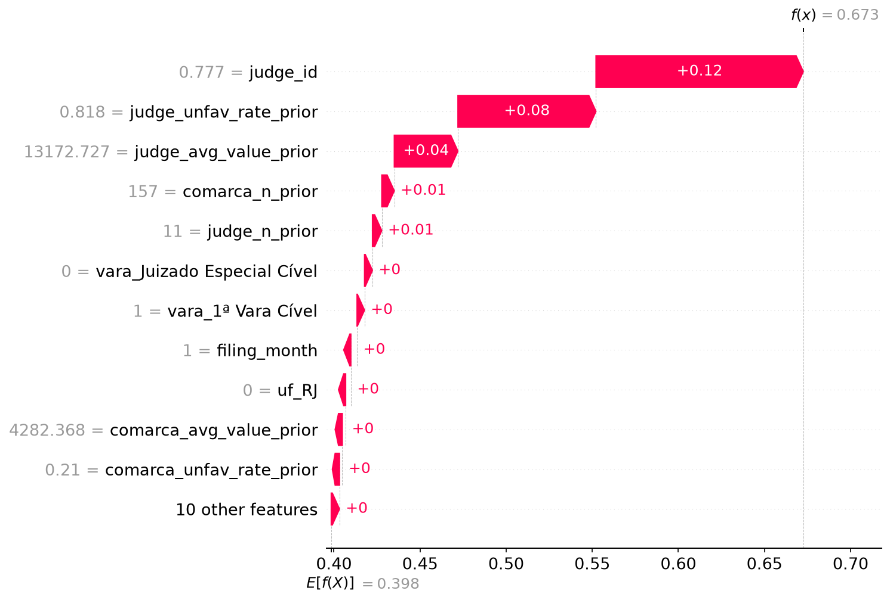

<!-- Hallmark pre-emit critique · P5 H5 E5 S5 R5 V4 · every figure copied from models/reports/shap/<task>/ -->

# 06 · SHAP run report

> **Synthetic testbed.** This page reports the controlled synthetic run
> (`claimvalue explain`), kept for tests and for a known-signal benchmark. The
> public SHAP run uses the ABJ book dataset; see
> [`10_book_results.md`](10_book_results.md). The numbers below are not real-world
> performance.

Run date 2026-11-10. Synthetic data, seed 42, 20,000 cases. Models trained on the past and scored
on a future window they never saw.

This document reports what the SHAP step produced. Every number comes from the files in
`models/reports/shap/<task>/`, and the additivity check in `shap_summary.json` backs the claim
that the explanations are complete. For the method behind the numbers, read `docs/07_shap.md`.

## What was run

```bash
claimvalue pipeline --n 20000   # generate -> anonymize -> SQL -> EDA -> train -> explain -> anomalies -> PII
claimvalue train --task both    # re-run with LightGBM installed: four-model leaderboard
claimvalue explain --task both  # TreeExplainer, 800 cases per task
pytest                          # full suite, including 4 SHAP tests and the explain-API test
```

Permutation importance in `docs/04_ml.md` §9 says which columns the model uses overall. It cannot
say why one case scored 67%. SHAP decomposes a single prediction into a signed contribution per
feature, and the contributions add up to the model output.

The saved artefacts are wrapped pipelines (`ColumnTransformer` then the tree, plus `log1p` for
money), so the explainer runs in the encoded space. `shap_explain.unwrap` recovers the tree and
the feature names, `encode_features` rebuilds the matrix the tree actually sees, and the check
`base_value + sum of contributions == model output` runs on every case.

LightGBM is included in the model search whenever the package is importable. On macOS, PyTorch and
LightGBM bring two OpenMP runtimes into one process; the test suite pins `OMP_NUM_THREADS=1` and
runs the torch test in a subprocess, which keeps collection and training from crashing.

Two choices are deliberate. Contributions stay in the model's own units (log1p(BRL) for
regression, classifier margin for classification), because converting them to "reais pushed" is
not additive and would be a false claim. And the explain step reads the same future test window
as evaluation, so no training row ever appears in an explanation.

## Verification

| Check | Classification | Regression |
|---|---|---|
| Explainer | TreeExplainer (exact) | TreeExplainer (exact) |
| Cases explained | 800, future window | 800, future window |
| Encoded features | 21 | 21 |
| Additivity max error | 8.9e-16 or better | 1.1e-14 or better |
| Output space | class-1 probability (forest) | log1p(BRL) |

An error at machine precision means nothing in the prediction is unaccounted for.

## Global importance, classification

| Rank | Feature | Mean absolute SHAP | Share |
|---|---|---|---|
| 1 | `judge_id` (target-encoded) | 0.0593 | 36.0% |
| 2 | `judge_unfav_rate_prior` | 0.0399 | 24.3% |
| 3 | `comarca` (target-encoded) | 0.0179 | 10.9% |
| 4 | `judge_avg_value_prior` | 0.0086 | 5.3% |
| 5 | `comarca_unfav_rate_prior` | 0.0075 | 4.5% |
| 6 | `judge_n_prior` | 0.0051 | 3.1% |

Judge-related features together account for 68.7%, court-level features 17.9%, and each remaining
feature (month, UF, vara) sits under 1.1%.

## Global importance, regression

| Rank | Feature | Mean absolute SHAP | Share |
|---|---|---|---|
| 1 | `judge_id` (target-encoded) | 0.6678 | 93.4% |
| 2 | `comarca_unfav_rate_prior` | 0.0076 | 1.1% |
| 3 | `judge_unfav_rate_prior` | 0.0074 | 1.0% |

Every feature except `judge_id` sits under 1.1%. This matches the warning in `docs/04_ml.md` §9
that `judge_id` encodes both the judge and the nested location, and it now shows per prediction
rather than only in aggregate.

## One case

The model scored one case at 67.3% probability of an unfavourable ruling. Its largest
contributions were `judge_id` (+0.120), `judge_unfav_rate_prior` (+0.080) and
`judge_avg_value_prior` (+0.037), in probability points. The starting point is the average
case, near 39%.



The bottom line is the average case, each bar is one feature's push, and the top line is the
prediction. The bars close exactly on the prediction. That is the difference between this chart
and a narrative that merely sounds plausible.

## Findings in plain language

Three sentences cover what a non-technical audience needs:

1. Who judges the case matters more than what the case asks for. The judge's identity and track
   record drive about two thirds of the outcome model, and the court adds about a fifth. The
   case's own attributes barely register.
2. Past behaviour outweighs any single attribute of a new case. That fits a model at AUC 0.68:
   useful for ranking and triage, not for deciding.
3. The claim-value model runs almost entirely on the judge's history. It works as a cross-check,
   not as an oracle, and the error-by-state report plus this breakdown are the two guardrails
   around that fact.

## Artefacts

```
models/reports/shap/classification/
    global_importance.csv  beeswarm.png  bar_mean_abs_shap.png
    waterfall_{highest,median,lowest}.png  dependence_*.png
    case_explanations.csv  shap_summary.json
models/reports/shap/regression/           same set
```

Code: `src/claimvalue/shap_explain.py`, `tests/test_shap.py`, `claimvalue explain`. The same
decomposition is available per request from `POST /explain/claim-value` and
`POST /explain/unfavorable-probability`.

## Limits

The data is synthetic, so the method transfers but the accuracy will not. SHAP describes what the
model used, not what causes an outcome. And `judge_id` carries location as well as identity, so
none of these numbers should be read as a claim about individual judges.
