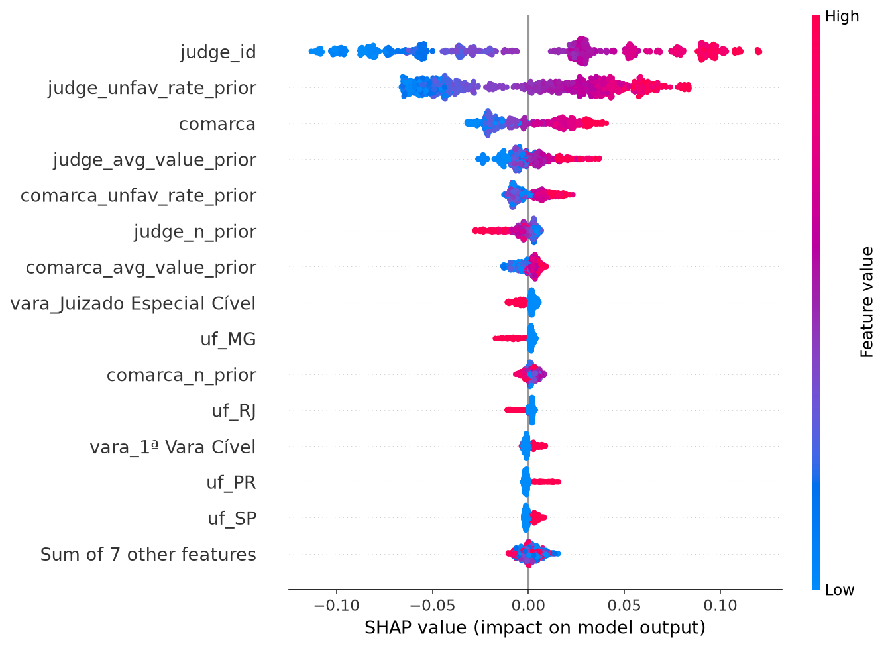
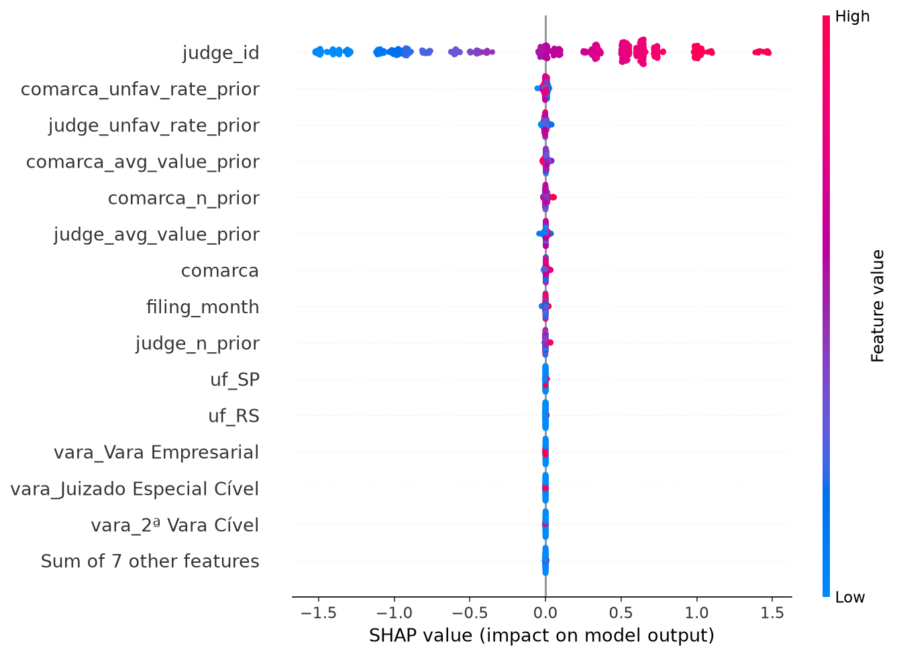
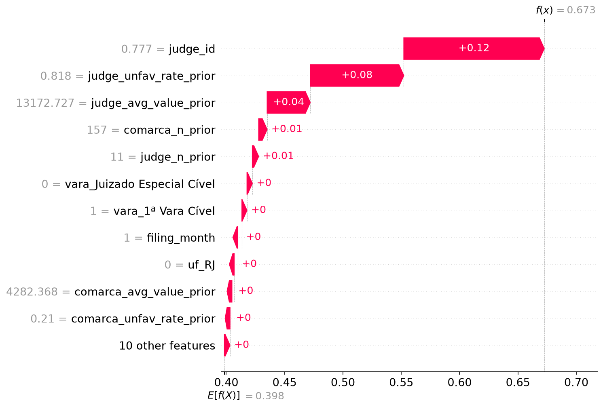

<!-- Hallmark pre-emit critique · P5 H5 E5 S4 R5 V5 · numbers traced to models/reports/shap/ and the pipeline log -->

# 07 · SHAP explained

> **Synthetic testbed.** The worked numbers and the run section describe the
> controlled synthetic pipeline, kept for tests and for a known-signal benchmark.
> The public SHAP run uses the ABJ book dataset; see
> [`10_book_results.md`](10_book_results.md). The method sections apply to both
> paths.

This is the long-form explanation of the SHAP layer in `src/claimvalue/shap_explain.py`. Sections
1 to 6 cover the method: the Shapley value, a worked example, the units the numbers come in and
how to read each plot. Section 7 compares p-values with SHAP. Sections 8 and 9 cover how the
explain step runs here and what the last run produced. Section 10 onward covers debugging,
limitations and the checklist.

If you only need the numbers from the last run, read `docs/06_shap.md`.

---

## 1. What SHAP returns

SHAP assigns every feature a signed number for a single prediction: how much that feature
moved the prediction away from the average, and in which direction. The numbers satisfy an
identity:

```
prediction = base_value + sum of the feature contributions
```

The base value is the average model output over the background data. Because the contributions
always add up to the prediction, the explanation is not a summary or a ranking. It is a complete
account of one prediction, and it can be checked with a subtraction.

That property is called additivity, or efficiency. `tests/test_shap.py` asserts it for every
case, and the pipeline prints the measured error on each run.

---

## 2. Three questions, one of which needs SHAP

Feature-importance tools answer a single question: which columns does the model use across the
whole dataset? A stakeholder usually asks a different one, about one case. The three questions
look similar and need different tools:

| Question | Scope | Tool |
|---|---|---|
| Which features does the model use overall? | whole model | permutation importance, mean absolute SHAP |
| Why did the model produce this number for this case? | one prediction | SHAP waterfall or force plot |
| How does the prediction change as one feature grows? | one feature | SHAP dependence plot |

Permutation importance cannot answer the second question. It shuffles a column and measures how
much average error gets worse, so it has no per-case output. SHAP produces all three views from
the same values.

---

## 3. Where the values come from

Shapley values come from cooperative game theory. The prediction is treated as a payout, the
features are the players, and the question is how to split the payout fairly.

Four properties define "fairly":

| Property | Meaning |
|---|---|
| Efficiency | the contributions add up exactly to the payout |
| Symmetry | two features that contribute the same in every context get the same credit |
| Dummy | a feature the model never uses gets zero |
| Additivity | explaining an average of models equals averaging the explanations |

Shapley proved that one rule satisfies all four. It averages a feature's marginal contribution
over every order in which the features could arrive:

```
phi_i = sum over subsets S not containing i of
        [ |S|! (F - |S| - 1)! / F! ] * ( v(S union {i}) - v(S) )
```

`F` is the number of features and `v(S)` is the model's output when only the features in `S`
are known, with the rest replaced by background values. In words: a feature's credit is the
average extra it adds when it joins every possible team, weighted by team size.

The formula is exponential in `F`, which matters for implementation. Section 5 explains why tree
models do not pay that cost.

---

## 4. A worked example

Take a small model with three features and a base rate of 55% (the average probability of an
unfavourable ruling). One case has a high claim value, court A, and a high lawyer win rate. The
model predicts 78%.

The payout to split is 78 − 55 = 23 points. The ledger for `claim_value` averages its
marginal effect over the six possible orders of revealing the three features. The intermediate
numbers are invented for the example; the procedure is what SHAP runs.

| Order of reveal | Marginal contribution of claim_value |
|---|---|
| Claim value first | 78 − 55 = +23 |
| Court first, then claim value | 70 − 60 = +10 |
| Lawyer first, then claim value | 68 − 62 = +6 |
| Court and lawyer first, then claim value | 78 − 70 = +8 |
| Remaining symmetric orders | averaged in the same way |
| Shapley value (average) | +12 |

Repeating the procedure for court gives +8 and for the lawyer's win rate −5. Those three
numbers are what a waterfall plot displays. Said aloud to a lawyer: "the average case is 55%;
the claim value pushed this one up 12 points, the court pushed it up 8, and the lawyer's record
pulled it down 5."

The sum closes on the prediction for the same reason the real pipeline's additivity check
passes: that is the efficiency property doing its job.

---

## 5. TreeSHAP, and why it is exact

Enumerating 2^F subsets is not feasible with 20 or 30 features. Lundberg and colleagues
published TreeSHAP in 2018: for tree ensembles it computes the exact Shapley values in
polynomial time by walking the tree structure instead of enumerating coalitions.

Three explainers matter in practice:

- **TreeExplainer** (`shap.TreeExplainer`): exact values for decision trees, random forests,
  gradient boosting, XGBoost and LightGBM. This is what the repo uses.
- **Permutation explainer**: model-agnostic. It estimates Shapley values by sampling feature
  orderings. Slower and approximate, and the fallback for models without a tree walker. sklearn's
  `HistGradientBoosting` is one example.
- **KernelSHAP**: the older general method, a weighted linear regression over coalitions. Slower
  and noisier than the permutation explainer. Rarely the right first choice today.

### 5.1 The output space

SHAP explains the model's own output, and that is not always the number shown to users:

| Task | Model output | SHAP unit |
|---|---|---|
| Claim value | `log1p(BRL)`, because the model trains on log money | points of log-BRL |
| Ruling outcome, boosted model | log-odds of `unfavorable` | log-odds |
| Ruling outcome, sklearn forest | class-1 probability, since each tree outputs a probability | probability points |

Waterfall plots show contributions in those units. For classification, `p = 1/(1+e^-x)` converts
back to probability; a +1.0 log-odds contribution multiplies the odds by about 2.7. For
regression, the contributions are in log space, so +0.69 roughly doubles the predicted money
regardless of whether the case is R$ 3,000 or R$ 300,000.

A contribution cannot be converted to a fixed number of reais, because `exp` is not additive. The
repo keeps the log unit and labels it instead of inventing a reais column.

---

## 6. Three plot types

| Level | Plot | Question it answers | File in this repo |
|---|---|---|---|
| One prediction | waterfall | Why this number for this case? | `waterfall_{highest,median,lowest}.png` |
| Whole model | beeswarm, mean-\|SHAP\| bar | Which features matter overall? | `beeswarm.png`, `bar_mean_abs_shap.png`, `global_importance.csv` |
| One feature | dependence | How does this feature move predictions? | `dependence_<feature>.png` |
| Machine-readable | CSV and JSON | Feed a report or the API | `case_explanations.csv`, `shap_summary.json` |

How to read them:

**Waterfall.** Starts at the base value and stacks signed contributions until it reaches the
case's prediction. Features are sorted by absolute contribution; small ones are bundled. The
numbers close exactly, so the plot doubles as an audit trail.

**Beeswarm.** Each dot is one case. The x-axis is the contribution, the y-axis is the feature
sorted by global importance, and the colour is the feature's value (red high, blue low). It
shows importance, direction and the value-effect relationship in one view. A red cluster on the
right of `judge_avg_value_prior` means high past averages push predictions up, for many cases.

**Bar (mean absolute SHAP).** The global ranking, useful in slides. It hides direction, so pair
it with the beeswarm whenever someone asks whether high values raise or lower the prediction.

**Dependence.** A scatter of the feature's value against its contribution. Flat regions mean the
model ignores the feature there, steps mean thresholds, and curves usually mean interactions.
It is the honest replacement for a linear coefficient in a nonlinear model.

---

## 7. P-values and SHAP

> **Book-data run.** The book pipeline now executes this comparison: a paired
> Wilcoxon signed-rank test of per-case loss against the no-skill baseline.
> Results: p = 0.280 (claim value) and p = 0.846 (appeal reform); see
> [`10_book_results.md`](10_book_results.md) section 4. The synthetic worked
> example below explains the concepts.

The two answer different questions and belong to different fields. Neither replaces the other.

| | P-value | SHAP |
|---|---|---|
| Question | Is this effect real, or could it be chance? | How much did each feature push this prediction? |
| Field | Statistical hypothesis testing | Model explanation, from game theory |
| Output | One probability, for example p = 0.003 | A signed number per feature, per prediction |
| Tells you | Whether a relationship is statistically significant | Size and direction of each feature's contribution |
| Works on | A hypothesis about a parameter, such as a regression coefficient | Any trained model, including XGBoost, LightGBM and random forests, which have no coefficients |
| Does not tell you | How much a feature mattered for one case | Whether the effect is statistically significant |
| Direction | The coefficient sign, if the model is signed | Yes, signed |
| Magnitude | No; a p-value says nothing about effect size | Yes; that is its output |
| Baseline | The null hypothesis | The average prediction |
| Unit | A dimensionless probability | The model's output unit: log-odds, log-BRL or probability |
| Assumes | A specific parametric model | Nothing about the model, but the explanation describes that model, not reality |

### 7.1 Why the p-value alone is not enough here

A p-value answers whether an effect is distinguishable from noise. It does not answer how large
the effect is. With enough data a trivial effect becomes significant; with little data a large
effect can fail to reach it. SHAP is the opposite: it reports magnitudes and says nothing about
whether the pattern generalises beyond the test window.

### 7.2 Using them together

The two fit into one workflow:

1. Validate with statistics. Compare models using bootstrap confidence intervals (the repo does
   this in `bootstrap_ci`), check that cross-validation and test scores agree, and confirm the
   relationship is stable across time slices.
2. Explain with SHAP. Show what the deployed model uses and how each prediction was assembled.
3. Audit the pair. A feature with a large SHAP contribution that no domain expert can justify,
   and that was never checked for significance, is the most reliable leakage signal available.

### 7.3 Can a SHAP value have a confidence interval?

Yes, by bootstrap. Resample the test cases, recompute mean absolute SHAP per feature, and report
the 2.5th to 97.5th percentile. A feature whose band straddles zero has an unstable explanation.
The bootstrap code already used for MAE and ROC-AUC applies unchanged.

### 7.4 One sentence for the report

A p-value asks whether a relationship exists beyond this dataset. SHAP asks how the model used
its inputs for one case. A serious project needs both.

---

## 8. Running it in this repository

### 8.1 Install

```bash
pip install -e ".[explain,gbm]"   # shap, matplotlib, lightgbm
brew install libomp               # macOS only, for LightGBM
```

### 8.2 Two commands

```bash
claimvalue train --task both
claimvalue explain --task both --max-cases 800
```

`explain` calls `train.load_task_data()`, so it always explains the same future test window the
champion model was scored on. It never uses training rows and never resamples the whole dataset.

### 8.3 Why the pipeline has to be unwrapped

The saved artefact is not a bare tree:

```
regression:      TransformedTargetRegressor(log1p/expm1 around Pipeline(pre -> tree))
classification:  Pipeline(pre -> tree)
```

`TreeExplainer` needs the tree and rows in the tree's encoded space (one-hot `uf` and `vara`,
target-encoded `judge_id` and `comarca`, numeric passthrough). `shap_explain.py` does four
things:

1. Unwrap: `fitted.regressor_` for regression, then `named_steps["pre"]` and `["model"]`.
2. Re-encode: `pre.transform(X)` into a DataFrame, keeping feature names from
   `get_feature_names_out()` with the prefixes stripped.
3. Explain with TreeExplainer, or the permutation explainer when no tree walker exists.
4. Check additivity for every case and record the maximum error in `shap_summary.json`.

### 8.4 Minimal script, including XGBoost and LightGBM

For a model that takes a raw frame, the whole explanation is six lines:

```python
import shap, joblib, pandas as pd

model = joblib.load("models/classification.joblib")
X = pd.read_parquet("test_features.parquet")
explainer = shap.TreeExplainer(model)
shap_values = explainer(X)
shap.plots.beeswarm(shap_values)
shap.plots.waterfall(shap_values[0])
```

With this repo's wrapped pipelines, call `claimvalue explain` or reuse `unwrap` and
`encode_features` from `shap_explain.py`. For XGBoost and LightGBM, TreeSHAP walks the model
directly:

```python
import xgboost as xgb, lightgbm as lgb, shap

booster = xgb.XGBClassifier(n_estimators=300, max_depth=4).fit(X, y)
sv = shap.TreeExplainer(booster)(X)  # exact, raw log-odds contributions

lgbm = lgb.LGBMClassifier(n_estimators=300).fit(X, y)
sv = shap.TreeExplainer(lgbm)(X)  # also exact
```

### 8.5 Artefacts

```
models/reports/shap/<task>/
    global_importance.csv        feature, mean_abs_shap, mean_shap_signed, share_pct
    beeswarm.png
    bar_mean_abs_shap.png
    waterfall_highest.png
    waterfall_median.png
    waterfall_lowest.png
    dependence_<feature>.png     top four features
    case_explanations.csv        one row per case and feature
    shap_summary.json            explainer, additivity check, one-case story
```

`case_explanations.csv` is the join key for a product surface: attach the rows to a case number
and the "why" can be rendered next to the prediction.

### 8.6 Explaining one case over the API

```bash
curl -s -X POST localhost:8000/explain/unfavorable-probability \
  -H "X-API-Key: $API_KEY" -H 'content-type: application/json' \
  -d '{"uf":"SP","comarca":"Campinas","vara":"1a Vara Civel",
       "judge_id":"JUDGE_unknown","filing_month":5,
       "judge_unfav_rate_prior":0.45,"comarca_unfav_rate_prior":0.4}'
```

The response includes the prediction, the base value, the top five contributions and the
additivity error:

```json
{
  "unit": "raw classifier margin (log-odds for boosted models, probability for forests)",
  "base_value": 0.41,
  "raw_prediction": 0.52,
  "additivity_error": 1.7e-16,
  "probability_unfavorable": 0.4322,
  "top_contributions": [
    {"feature": "judge_unfav_rate_prior", "shap": 0.0345},
    {"feature": "judge_id", "shap": -0.0205}
  ]
}
```

For a model without an exact tree walker the endpoint returns 501 with a clear message. That is
deliberate: an approximate explanation presented as exact would be worse than no explanation.

---

## 9. Results from the executed run

800 cases per task, future test window, exact TreeExplainer.

| Check | Classification | Regression |
|---|---|---|
| Explainer | TreeExplainer | TreeExplainer |
| Encoded features | 21 | 21 |
| Additivity max error | 8.9e-16 or better | 1.1e-14 or better |
| Output space | class-1 probability (forest) | log1p(BRL) |

An additivity error at machine precision means the explanation accounts for the entire
prediction on every case, with nothing left over.

### 9.1 Global importance, classification

| Rank | Feature | Mean absolute SHAP | Share |
|---|---|---|---|
| 1 | `judge_id` (target-encoded) | 0.0593 | 36.0% |
| 2 | `judge_unfav_rate_prior` | 0.0399 | 24.3% |
| 3 | `comarca` (target-encoded) | 0.0179 | 10.9% |
| 4 | `judge_avg_value_prior` | 0.0086 | 5.3% |
| 5 | `comarca_unfav_rate_prior` | 0.0075 | 4.5% |
| 6 | `judge_n_prior` | 0.0051 | 3.1% |

Judge-related features together make up 68.7% of the model's reasoning, court-level features
17.9%, and every remaining feature sits under 1.1%. `judge_id` carries both the judge and the
location, so this is not a claim that individual judges cause outcomes. Section 10 covers how to
audit that.



In the top row, red dots sit to the right: high judge encodings push predicted risk up.
`judge_unfav_rate_prior` shows the same slope. A wide vertical spread on one feature means the
direction depends on the case.

### 9.2 Global importance, regression

| Rank | Feature | Mean absolute SHAP | Share |
|---|---|---|---|
| 1 | `judge_id` (target-encoded) | 0.6678 | 93.4% |
| 2 | `comarca_unfav_rate_prior` | 0.0076 | 1.1% |
| 3 | `judge_unfav_rate_prior` | 0.0074 | 1.0% |

One feature carries almost the whole model. That is worth showing to stakeholders, because the
permutation-importance table only hinted at the concentration and could not show it per case.



### 9.3 One case

The highest-risk case in the sample was scored 67.3% against the company, against a base rate
near 39%. Its largest contributions were `judge_id` (+0.120), `judge_unfav_rate_prior` (+0.080)
and `judge_avg_value_prior` (+0.037), in probability points.



The bottom line is the average case, each bar is one feature's push, and the top line is the
prediction. The bars close on the prediction, which is what separates the chart from a
plausible narrative.

### 9.4 What to say in the defence

For classification: the model's reasoning is dominated by who judges the case and where, not by
the case's own attributes, which is consistent with a ranking tool at AUC 0.68 rather than an
automated decision.

For regression: 93% of the money prediction is the judge's history. The error-by-state report
and this breakdown are the guardrails, and the honest description is a cross-check, not an
oracle.

---

## 10. Debugging and fairness

Explaining the model surfaces problems that accuracy hides.

| Pattern in the output | Likely cause | Action |
|---|---|---|
| An id-like feature with large SHAP values | Identifier or temporal leakage | Drop it, retrain, re-explain |
| A feature that should not matter dominating | Leakage or a proxy variable | Audit the SQL window in `03_abt.sql` |
| A protected attribute with systematic signed effects | Bias in data or labels | Slice analysis, document, escalate |
| Near-zero SHAP for a feature that should matter | Target-encoding shrinkage, or the feature is unreachable in the trees | Check encoding coverage and interactions |
| A waterfall that contradicts common sense | Outlier | Cross-check with `anomalies.csv` |

This is part of why the role asks for SHAP: the same output serves stakeholder communication and
model debugging.

---

## 11. Compared with permutation importance

| | Permutation importance | SHAP |
|---|---|---|
| Question | How much does average error worsen if this column is destroyed? | How was each prediction assembled? |
| Scope | Global only | Global and per prediction |
| Correlated features | Understates the first, overstates the second, because shuffling creates impossible rows | Splits credit between correlated features |
| Output | One number per feature | Signed, per feature, per case |
| Cost | Cheap, k refits | Near-instant with TreeExplainer |

The repo keeps both. A large disagreement between the two global rankings is itself a signal
that one of them is being fooled.

---

## 12. Limitations

1. Correlated features split the credit. `judge_avg_value_prior` and
   `comarca_avg_value_prior` overlap, so each under-reports what the pair carries. Mean absolute
   SHAP is not causal importance.
2. The background data sets the base value. Shapley values are relative to a reference
   distribution. This repo uses the future test window, which matches deployment. A different
   background produces a different baseline and different plots.
3. SHAP explains the model, not the world. A faithful explanation of a leaky model is still an
   explanation of a leaky model.
4. Explainers differ in cost and exactness. `shap_summary.json` records which one produced each
   artefact.
5. Units need translating for a non-technical audience. Log-odds and log-BRL are not intuitive.
6. Additivity is the safety net. If a custom pipeline breaks `base + sum of contributions =
   output`, the unwrapping is wrong, and the test fails.

---

## 13. Checklist for the capstone

- [x] TreeExplainer for both tasks, with additivity verified per case and tested
- [x] Global artefacts: beeswarm, bar, `global_importance.csv`
- [x] Per-case artefacts: three waterfalls, `case_explanations.csv`, `/explain` endpoints
- [x] Per-feature artefacts: dependence plots for the top four features
- [x] LightGBM in the leaderboard
- [x] P-value comparison (section 7)
- [ ] On real data: run the section 10 audit before quoting any plot externally
- [ ] Optional: bootstrap the mean-|SHAP| ranking and report the band

---

## 14. Glossary

**Shapley value.** A feature's fair average marginal contribution across all feature orderings.

**Base value.** The average model output over the background data; the waterfall's starting
point.

**TreeSHAP.** The exact polynomial-time algorithm for tree ensembles.

**Additivity.** `base + sum of contributions = prediction`, on every case. The property that
makes the explanation auditable.

**Beeswarm.** The dot-cloud plot showing importance, effect and feature value together.

**Dependence plot.** A scatter of one feature's value against its contribution.

**Permutation explainer.** A model-agnostic Shapley estimator, used when no tree walker exists.
