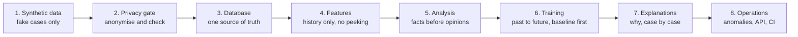
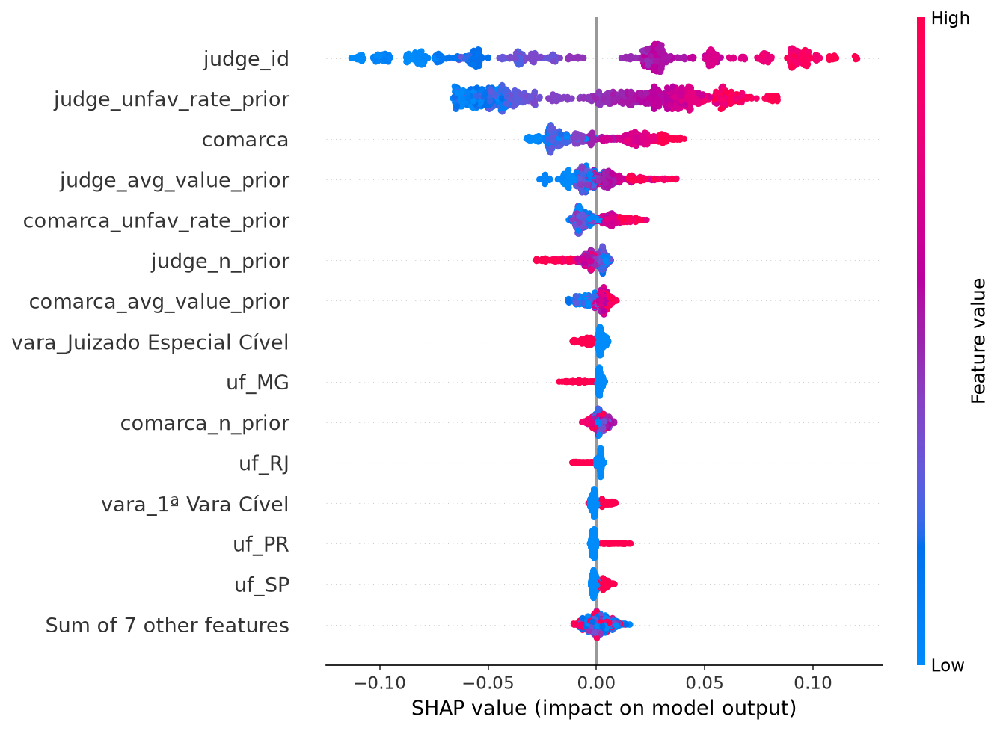

<!-- Hallmark pre-emit critique · P5 H5 E5 S5 R5 V4 · claims traced to the run log, tests and model cards -->

# 08 · For non-technical readers

> **Synthetic testbed.** This guide describes the controlled synthetic pipeline,
> kept for tests and for a known-signal benchmark. The public analysis uses the
> ABJ book dataset; see [`09_book_dataset.md`](09_book_dataset.md) and
> [`10_book_results.md`](10_book_results.md). The numbers below are not real-world
> performance.

This document explains the claimvalue-ml project to managers, executives and other non-technical
readers. It covers what the system does, how the pipeline is built and operated, what was verified,
and where the limits are. It avoids code and assumes no statistics.

> **Scope.** This page describes the synthetic testbed. The public analysis uses the ABJ book
> dataset; see `docs/09_book_dataset.md` and `docs/10_book_results.md`. This is a personal study
> project. It is not connected to any employer or real legal case, and contains no confidential or
> NDA-protected material. See `DISCLAIMER.md` for the full statement of provenance.

Engineers should start at `docs/00_data_lifecycle.md` and read in order. Model detail is in
`docs/04_ml.md`; explainability is in `docs/06_shap.md` and `docs/07_shap.md`; privacy is in
`docs/LGPD.md`.

## 1. What the project does

Two questions decide money and strategy in a court-case portfolio. How much is this claim likely
to be worth? How likely is the ruling to go against the company? Today both are answered from
experience and spreadsheets, which is slow, inconsistent and hard to audit.

The repository is a complete system that answers both from historical, anonymised data. It also
explains every prediction in terms a lawyer can challenge. Each stage runs as a command, each
stage is tested, and each decision is written down.

A senior reviewer will check three things:

| What they ask | What the repository shows |
|---|---|
| Can I trust the numbers? | Training on the past and testing on the future, a dummy baseline for every model, and a 95% confidence interval on each headline metric |
| Can I trust the code? | 49 automated tests, linting, a CI pipeline that runs on every change, a containerised API, and no secrets in the repository |
| Will anyone understand a prediction? | SHAP explanations for individual cases, with an arithmetic proof that the explanation adds up to the prediction |

On 20,000 synthetic cases the claim-value model cuts average error by about 31% against a naive
baseline (R$ 3,396 against R$ 4,910), and the ruling-outcome model ranks cases well above chance
(ROC-AUC 0.682 against 0.500). Both results are modest by design of the data, and both are
presented as they are.

## 2. Why it matters commercially

| Stakeholder | The problem today | What changes |
|---|---|---|
| Legal operations | Two people give two estimates for the same case | A consistent first estimate in seconds, with the reasons attached |
| Finance and provisioning | Reserves are set late and conservatively | An early exposure estimate with a range and a confidence level |
| Litigation strategy | Settle or proceed is a gut call | A risk score that ranks cases, with the drivers shown |
| Compliance and the DPO | Black-box tools are unacceptable under LGPD | Anonymisation at the gate, no personal data in the model, decisions that can be explained |
| Leadership | No way to audit "the algorithm says so" | Every prediction splits into named factors that anyone can check |

## 3. Explaining one prediction

The model says a particular case has a 67% chance of going against the company. A lawyer asks
why. "What did I do wrong?"

A p-value cannot answer that. It says whether a pattern probably exists across the whole dataset,
which is a yes or no about the dataset, not a reason for one case.

SHAP can. It treats the prediction as an amount to be divided among the reasons and gives each
one a signed score:

| Reason | Effect on this case |
|---|---|
| The judge's track record | +12 points, raises risk |
| The district's history | +8 points |
| Case type | +5 points |
| Lawyer's past win rate | −2 points, lowers risk |
| Starting point, the average case | 55% becomes 78% |

The scores add up exactly to the prediction, which is what makes the explanation auditable rather
than persuasive. The full comparison between p-values and SHAP is in `docs/07_shap.md` section 7.

One sentence captures the difference. A p-value asks whether a relationship is real or chance.
SHAP asks why the model said this about this case. A serious project needs both: statistics to
trust the model, SHAP to defend a decision.

## 4. The pipeline, stage by stage

This is not a notebook. It is a pipeline in which every stage is a repeatable command with a
guard rail. Raw data goes in at one end, and anonymised, model-ready data plus evidence comes out
at the other.



| # | Stage | What it does | How it is controlled | Evidence |
|---|---|---|---|---|
| 1 | Generate | Builds 20,000 realistic but fictional cases so the system can be shown without exposing anyone's data | Invalid IDs, random names, fixed seed for reproducibility | The pipeline runs with no real data |
| 2 | Privacy gate | Removes or scrambles names, IDs and case numbers before analysis, and stops if anything identifying survives | Keyed pseudonyms, date shifting, amount rounding, a PII scan that fails closed | 21 privacy tests, audit in `docs/06_anonymization_audit.md` |
| 3 | Database | Loads clean data into a store that rejects bad records | Schema constraints, primary key, a data-quality report | 7 data-contract tests |
| 4 | Features | Turns raw cases into what was known before the case was filed, which is the main defence against cheating | Rolling window strictly before the filing date, label purge for stale outcomes | Tests assert that no future information leaks in |
| 5 | Analysis | Produces the facts leadership asks for: volume over time, outcome rates by state, missing data | Analysis as code, every finding saved as a table, a chart and a written reading | The report regenerates on every run |
| 6 | Training | Learns on older cases and tests on newer ones the model has never seen | Time-series cross-validation, tuning only on training data, dummy baselines, confidence intervals, MLflow | 6 model tests, results below |
| 7 | Explanations | Shows which factors pushed each prediction up or down, offline for all cases and live through the API | Exact TreeSHAP, additivity checked per case, plots plus CSV plus endpoint | 4 SHAP tests and one explain-API test, `docs/07_shap.md` |
| 8 | Operations | Flags unusual claims, serves predictions through a secured API, rebuilds on every code change | Isolation Forest, API key and input validation, non-root container, GitHub Actions, pre-commit hooks, secret scanning | `.github/workflows/ci.yml` |

### 4.1 How it is operated

| Practice | What it means in business terms | Where |
|---|---|---|
| One-command run | Anyone can recreate every result from scratch, with no tribal knowledge | `claimvalue pipeline --n 20000` |
| CI/CD | Every change is linted, tested and smoke-run before it can ship | `.github/workflows/` |
| Environment parity | The same container runs on a laptop and in the cloud | `Dockerfile` |
| Secrets hygiene | No keys in the repository, and a leaked secret is caught automatically | `.env` and gitleaks |
| Experiment tracking | Every model records its settings, data fingerprint and scores | MLflow |
| Rollback | The previous model stays on disk with its metadata, and promoting a new one is a file swap | `models/*.json` |
| Monitoring | Drift and error alerts are the next increment; the data-quality report is the starting point | `docs/04_ml.md` §10 |
| Reproducibility | The same seed produces the same numbers | fixed `SEED = 42` |

## 5. What was verified

Everything below was executed on 2026-11-10 for the **synthetic testbed**. Public results are in
`docs/10_book_results.md`.

| Check | Result |
|---|---|
| Automated tests | The full suite passed, including the SHAP tests, the explain-API test, privacy tests and leakage tests |
| Linting and formatting | ruff clean |
| Full pipeline, 20,000 synthetic cases | Completed: generate, anonymise, SQL, EDA, train, explain, anomalies, PII check |
| Privacy scan after anonymisation | Passed, no CPF, CNPJ or case-number patterns |
| SHAP additivity | Maximum error 8.9e-16 for classification and 1.1e-14 for regression, so the explanation reconstructs the prediction to machine precision |
| Regression against baseline | MAE R$ 3,396 against R$ 4,910 |
| Classification against baseline | ROC-AUC 0.682 against 0.500 |

### 5.1 Results, and how to read them

Claim value:

| Model | Test MAE | Typical percentage error |
|---|---|---|
| Naive baseline, always the median | R$ 4,910 | 59% |
| Decision tree | R$ 3,410 | 39% |
| LightGBM | R$ 3,403 | 39% |
| Random forest, chosen | R$ 3,396 | 39% |
| 95% confidence interval of the winner | R$ 3,231 to R$ 3,543 | |

Ruling outcome:

| Model | ROC-AUC |
|---|---|
| Naive baseline | 0.500 |
| LightGBM | 0.683 |
| Random forest, chosen | 0.682 |
| 95% confidence interval of the winner | 0.666 to 0.699 |

Three honest notes. The tree models are statistically indistinguishable, because the gaps are
smaller than the confidence intervals, so the method and the audit trail matter more than the
third decimal. R² of 0.38 and AUC of 0.68 are modest and are presented as modest: useful for
ranking and triage, not for automated decisions. And the data is synthetic, so real-world
accuracy will differ even though the pipeline transfers.

## 6. What the explainability work found

The addition matters in two ways. Before, the team had a global importance list, which says which
columns the model uses on average. A lawyer cannot challenge an average. Now each case has named,
quantified reasons, and a biased or leaky model is harder to hide because odd drivers show up in
the per-case output.

The p-value and SHAP comparison, in one table:

| | P-value | SHAP |
|---|---|---|
| Question | Is this effect real, or could it be chance? | How much did each factor push this prediction? |
| Field | Statistics, hypothesis testing | Model explanation, from game theory |
| Output | One probability, such as p = 0.003 | A signed number per factor, per case |
| Tells you | Whether a relationship is statistically significant | Size and direction of each factor's contribution |
| Works on | A hypothesis about a parameter, such as a regression coefficient | Any trained model, including ones with no coefficients |
| Does not tell you | How much a factor mattered for one case | Whether the pattern is statistically significant |
| Best used for | Should we trust this relationship? | Why did the model decide this? |
| Risk if misused | p below 0.05 does not mean important, and p above 0.05 does not mean no effect | A large SHAP value can expose a leak, because it explains even a bad model faithfully |

What the last run showed:

- Ruling outcome. The judge's identity and track record account for about 69% of the model's
  reasoning, and the district adds about 18%. Month, state and court type are near noise. This is
  a who-and-where model, not a what model, which is why it ranks cases but should not decide them.
- Claim value. 93% of the prediction is the judge's history. SHAP makes that concentration
  visible, so nobody mistakes the model for an oracle.
- One case. The highest-risk case scored 67.3% against the company, against an average near 39%.
  The three largest contributions were the judge (+0.120), the judge's unfavourable rate (+0.080)
  and the judge's average values (+0.037), in model units.
- The audit proof. Base value plus all contributions equals the model output, to 15 decimal
  places, on every one of the 800 cases per task.

This is the chart to put on screen for a board:



Each dot is a case. The horizontal position is how much that factor pushed the prediction. The
judge's identity and track record dominate, and the case's own attributes barely register.

For a meeting, the sentence to use is this: the model's reasoning is dominated by the judge's
history, here is the arithmetic for this case, and that is why the system ranks cases instead of
deciding them. It is accurate, it avoids a causal claim, and it survives follow-up questions.

## 7. Risks and limits

| Risk | What it means in plain language | Status |
|---|---|---|
| Synthetic data | The demo data is fictional, so real accuracy will differ | The method transfers; rerun the same commands on a real anonymised export |
| Modest accuracy | An AUC of 0.68 supports ranking, not proof | Positioned as triage, with the baseline and confidence intervals published |
| LGPD | Pseudonymised data is still personal data while the key exists | Privacy gate and a written risk assessment in `docs/LGPD.md`; a DPO must sign off on legal sufficiency |
| Judge profiling | A model that leans on individual judges can be unfair or sensitive | Court-level features where possible, SHAP exposes the concentration, error-by-state report included |
| Causality | SHAP explains the model, not the law | Documented in every explainability doc |
| macOS and LightGBM | Two OpenMP runtimes, PyTorch and LightGBM, can crash one test process | The deep-learning test runs in an isolated subprocess |
| Portfolio-scale infrastructure | SQLite and single-machine runs suit a demo, not production volume | Scaling path in `docs/01_etl.md` |

## 8. Running it

```bash
# 1. Install, Python 3.11 or newer
uv sync --extra dev --extra api --extra eda --extra dl
# or: pip install -e ".[dev,api,eda,dl]"

# 2. Configure, never commit secrets
cp .env.example .env     # set ANONYMIZATION_PEPPER and API_KEY

# 3. Everything, about 10 minutes on a laptop
claimvalue pipeline --n 20000

# 4. Inspect the evidence
models/reports/shap/*/            # SHAP plots, CSVs and the additivity proof
models/reports/*_leaderboard.csv  # every model against the baseline
models/regression.json            # model card: metrics, parameters, data fingerprint

# 5. Serve predictions and explanations
uvicorn claimvalue.api:app
#   POST /predict/claim-value
#   POST /predict/unfavorable-probability
#   POST /explain/claim-value
#   POST /explain/unfavorable-probability
#   all require the header X-API-Key

# 6. Verify
pytest && ruff check .
```

The full pipeline takes roughly 8 to 12 minutes, mostly training. The test suite takes one to two
minutes.

## 9. Who should read what

| Reader | Sections | Decision it supports |
|---|---|---|
| CEO or board | 1, 5, 7 | Fund the work, set the accuracy bar |
| CFO or finance | 5, the claim-value table | How far to trust provisioning estimates |
| Head of legal operations | 3, 6 | Whether to use the tool for triage |
| DPO or compliance | 7, plus `docs/LGPD.md` | Whether data handling is acceptable |
| CTO or engineering | 4, 5, plus the README | Whether it is safe to deploy |
| HR or talent | This whole document | Whether the candidate can communicate and engineer, not only model |
| Data team | `docs/00` to `docs/07` | How to extend it |

## 10. Glossary

| Term | Meaning |
|---|---|
| Machine learning | Software that learns patterns from examples instead of being given rules |
| Model | The learned pattern, saved as a file that can score new cases |
| Prediction | The model's answer for one case, a value in reais or a probability |
| Feature | An input the model may use, such as the judge's prior unfavourable rate |
| Target | The thing being predicted, claim value or unfavourable ruling |
| Training and test split | Learn on older cases and grade on newer ones the model has never seen |
| Baseline | The simplest possible model, used as the bar to beat |
| ROC-AUC | Ranking quality: 0.5 is a coin flip, 1.0 is a perfect ordering |
| MAE | Mean absolute error: how far off the model is on average |
| Confidence interval | The range the true score is likely to fall in |
| Leakage | Letting the model see the answer, the most expensive mistake in ML |
| Cross-validation | Repeated train and validate splits inside the training period |
| Anonymisation | Removing or scrambling data that could identify a person |
| PII | Personally identifiable information, such as a name, ID or case number |
| LGPD | Brazil's data-protection law |
| ETL | Extract, transform, load: the plumbing that moves data safely |
| ABT | Analytical base table, one clean row per case built only from pre-outcome facts |
| EDA | Exploratory data analysis, understanding the data before modelling |
| CI/CD | Automated checks and delivery on every change |
| Container | A sealed environment that runs the same way everywhere |
| API | The interface other systems use to request a prediction |
| MLflow | A logbook for experiments: settings, data version and scores |
| p-value | The probability of seeing this result if there were no real effect |
| SHAP | A method that splits one prediction into signed per-factor contributions |
| Shapley value | The fair-share rule from game theory that SHAP is built on |
| Additivity | The guarantee that contributions sum exactly to the prediction |
| Waterfall plot | The picture of one case: start at the average and add each factor |
| Beeswarm plot | The whole-model picture, with every case and factor |
| Drift | When real-world data slowly stops resembling the training data |
| Rollback | Reverting to the previous working model version |

## 11. Talking points

Worth saying to a reviewer:

- The work covers the full lifecycle: privacy gate, feature layer, temporal validation,
  explainability and CI, not only a model.
- The leakage defences are tested, not just the accuracy.
- The difference between a p-value and a SHAP value is clear, and each is used for its own
  question.
- The model ranks cases and does not decide them, and that can be shown per prediction.

Worth avoiding:

- "The model is 93% accurate." It is not, accuracy is a different metric, and the honest numbers
  are MAE and AUC.
- "SHAP proves causation." It does not, and a senior reviewer will catch it.
- "The judge causes the outcome." The model uses judge history, which is not a causal claim.

## 12. Where things live

| You want | Go to |
|---|---|
| The full engineering story | `docs/00` through `docs/05` |
| Model results and validation design | `docs/04_ml.md` |
| SHAP run report | `docs/06_shap.md` |
| SHAP tutorial and the p-value comparison | `docs/07_shap.md` |
| Privacy and LGPD | `docs/LGPD.md` and `docs/06_anonymization_audit.md` |
| Code | `src/claimvalue/` |
| Tests | `tests/` |
| CI, container and hooks | `.github/workflows/ci.yml`, `Dockerfile`, `.pre-commit-config.yaml` |
| Results | `models/reports/` |
